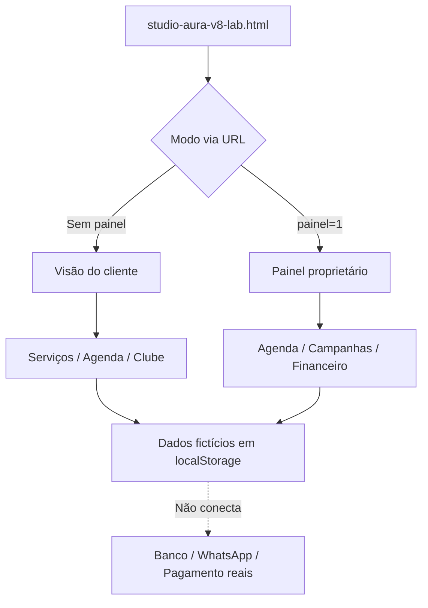

# Laboratório de design Studio Aura V8 — 30/10/2026

## Escopo e integridade
- Projeto: Move Digital / La'Bella (demonstração).
- Arquivo de origem: `studio-aura-v7.html`.
- Experimento: `studio-aura-v8-lab.html`, somente na branch `experimentos/design-taste-2026-10-30`.
- `main`, `index.html` e `studio-aura-v7.html` **não foram modificados**.
- Proposta visual: identidade editorial premium, tipografia hierarquizada, CTAs mais nítidos, cartões leves, adaptação a telas pequenas e respeito a redução de movimentos.
- Método: aplicação manual de princípios de design explicados publicamente pelo Taste Skill. **Não foi executado o instalador oficial `npx skills add` neste ambiente**.

## Arquitetura observada na V7 e preservada na V8

## Alterações controladas
1. Cópia da V7 em arquivo V8 independente, preservando rotinas e dados de exemplo.
2. Chave localStorage separada: `move_digital_premium_demo_v8_lab`, para não misturar com a V7.
3. Links internos de cliente e proprietário apontam para a V8.
4. Camada CSS experimental por cima do tema original, sem refatorar lógica comercial.
5. Aviso `LAB V8`, meta `noindex,nofollow`, compatibilidade com `prefers-reduced-motion`.
6. Nenhum disparo de WhatsApp, notificação, cobrança ou reserva remota ativado.

## Verificações
- Script JavaScript compila sem erro sintático.
- Smoke test com simulação controlada de DOM verificou renderização cliente, agenda, clube, painel, cadastro e publicação LOCAL de campanha, isolamento e navegação.
- Teste reproduzível sem bibliotecas externas: `node --test tests/studio-aura-v8-lab.test.mjs`.
- GitHub Actions isolado para os arquivos V8 (execução em runner padrão público, sujeito ao estado do Actions no repositório).

## Não validado
- Nenhuma execução real em Safari / Chrome mobile, screenshot ou análise visual automatizada.
- APIs externas e disponibilidade de imagens Unsplash não foram testadas.
- Taste Skill e Understand Anything oficiais não foram instalados ou executados.
- Esta V8 é **demonstração**, sem autenticação, sincronização multiaparelho, push, pagamentos ou reservas reais.

## Critérios antes de aprovar um merge
- Revisão visual em iPhone e Android; teste dos links de navegação cliente ↔ painel.
- Confirmar fluxo de agendamento, reagendamento, pontos, campanhas, reinicialização, e separação do armazenamento.
- Conferir disponibilidade/licença de imagens e substituição por imagens autorizadas do salão.
- Revisar acesso, LGPD e backend antes de qualquer utilização comercial.

### Referências
- Taste Skill: https://github.com/Leonxlnx/taste-skill
- Understand Anything: https://github.com/Egonex-AI/Understand-Anything
